# Aurelia Estates

A responsive React and TypeScript property application with published Supabase listings, Supabase account access, shareable property pages, interactive charts and validated enquiry preview and authenticated submission.

## Current scope

The application reads published property records from Supabase and uses Supabase Auth for registration, email confirmation, sign-in, session restoration and sign-out. The existing listings, market figures and document records remain illustrative. Unverified partner branding is not presented on the homepage. KYC completion is simulated. Property enquiries can be validated, previewed and submitted by authenticated users with confirmed email addresses. Submitted enquiries are saved in Supabase; no enquiry email delivery is implemented. General contact and KYC forms remain previews. API documentation describes examples, not operational endpoints.

Identity verification, payment processing and live financial feeds are unavailable. Use fictional information for KYC and enquiry previews. Account sessions persist through Supabase-managed browser storage; unsaved form drafts reset on reload. The registration company field is not sent or saved. Guided local checks with the two approved accounts verified authentication and session behaviour; owner SQL confirmed their email-confirmation status and matching profiles. Cross-user isolation, live enquiry submission and production configuration remain unverified.

## Implemented features

- Property search combined with tier, country, currency and minimum-bedroom filters.
- URL-backed filters with browser Back/Forward support and unrelated query parameters preserved.
- Public `/properties/:propertyId` detail routes, direct loading, refresh and missing-property handling.
- Reusable property detail content shared by public pages and an accessible dashboard modal.
- Currency-separated portfolio totals and illustrative five-year cash-flow charts.
- Zod-validated, property-linked enquiry preview with edit/reset and transition focus management.
- Authenticated portfolio, intelligence and compliance dashboards; public information and legal-scope pages.
- Supabase email/password authentication, confirmation callback and resend, restored sessions and protected routes.
- Keyboard controls, native modal semantics, labelled forms and reduced-motion presentation.

## Technology and architecture

Versions below are resolved versions in `package-lock.json`, rather than dependency range declarations.

| Area | Technology | Resolved version |
|---|---|---|
| UI | React / React DOM | 19.2.7 |
| Language/build | TypeScript / Vite | 6.0.3 / 8.0.16 |
| Styling | Tailwind CSS | 3.4.19 |
| Routing | React Router DOM | 7.18.2 |
| Query cache | TanStack React Query | 5.101.0 |
| Local shared state | Zustand | 5.0.14 |
| Authentication | Supabase JS | 2.117.3 |
| Validation | Zod | 4.4.3 |
| Motion | Framer Motion | 12.40.0 |
| Charts | Recharts | 3.8.1 |
| Icons | Lucide React | 1.21.0 |
| Class composition | clsx / tailwind-merge | 2.1.1 / 3.6.0 |

`App.tsx` supplies the query client, router and Suspense fallback; each layout adds its own Suspense boundary so navigation paints while a route chunk loads. Pages and the dashboard layout are lazy imports; Vite automatically splits their dependency graph. Public pages use CSS transitions, while Framer Motion and its reduced-motion configuration load only with the dashboard, and Recharts loads only when a chart is shown. Zustand reflects Supabase session changes and holds UI state. React Query supplies one published-inventory cache, using native GET requests and Zod field mapping. The Auth SDK is dynamically imported separately from the application shell. Enquiry draft/preview state stays local to the form.

The diagrams below describe the current Supabase property, authentication and enquiry architecture.



[Editable Mermaid source](technical/aurelia/diagrams/application-architecture.mmd)

## Project structure and routes

```text
src/
  components/          Shared UI and landing-page sections
  features/            Authentication, properties, enquiries, analytics and KYC
  hooks/               In-memory Zustand store
  layouts/             Public and dashboard layouts
  pages/               Landing, account access and dashboard pages
    public/            Public information and property-detail pages
  types/               Shared TypeScript models
  lib/                 Shared utilities
tests/                 Automated regression tests
technical/aurelia/
  CODE_EVIDENCE.md      Source references and inspection steps
  PERFORMANCE.md        Verified local measurements
  diagrams/             Editable Mermaid sources and styled SVGs
  lighthouse/           Three curated genuine HTML reports
```

Routing is defined in [App.tsx](src/App.tsx). Public pages use [PublicLayout.tsx](src/layouts/PublicLayout.tsx); authenticated dashboards use [DashboardLayout.tsx](src/layouts/DashboardLayout.tsx). Feature code stays together under `src/features`, while route pages compose those features.

| Route | Purpose and access |
|---|---|
| `/` | Public homepage |
| `/properties/:propertyId` | Published property details and enquiry preview |
| `/portfolio-access` | Public portfolio overview |
| `/analytics`, `/compliance-info`, `/api-docs` | Public illustrative analytics, compliance scope and example API documentation |
| `/about`, `/careers`, `/press`, `/contact` | Public information pages |
| `/privacy`, `/terms`, `/cookies` | Public technical-scope and browser-storage information |
| `/login`, `/signup` | Supabase account access and email confirmation |
| `/auth/callback` | Confirmation-code exchange and expired-link feedback |
| `/dashboard` | Requires a restored authenticated session; redirects to `/dashboard/portfolio` |
| `/dashboard/portfolio` | Property filters, calculated summaries and modal |
| `/dashboard/intelligence`, `/dashboard/compliance` | Demo charts and simulated compliance workflows |

Navbar/footer links connect the public pages; dashboard navigation connects its three sections. The property modal links to the corresponding public detail route. Unknown application URLs redirect to the homepage; unknown property IDs show a missing-property state. Dashboard access waits for Supabase session restoration on reload.

## Inventory, filters and URL state

| ID | Sample property | Currency | Listed price | Tier | Bedrooms |
|---|---|---|---:|---|---:|
| prop-001 | The Sky Penthouse | USD | 15,500,000 | Ultra-Luxury | 4 |
| prop-002 | Villa d'Este Estate | EUR | 22,000,000 | Ultra-Luxury | 8 |
| prop-003 | Modern Minimalist Haven | USD | 4,500,000 | Luxury | 3 |
| prop-004 | Alpine Retreat Chalet | CHF | 8,900,000 | Premium | 5 |

The dashboard grid applies AND across selected filters. Text search checks title, address, city and country, ignoring case and surrounding whitespace. Tier counts are All **4**, Ultra-Luxury **2**, Luxury **1**, Premium **1**.

Query keys are `q`, `tier`, `country`, `currency` and `bedrooms`. Defaults are omitted; malformed values fall back to supported defaults. Search edits replace the current history entry; explicit filter changes create entries. For example, after signing in, `/dashboard/portfolio?country=Italy&currency=EUR&bedrooms=8` selects `prop-002`. Dashboard links do not bypass authentication; a reload restores a valid session before access is granted. Public `/properties/prop-002` works independently of sign-in.

`/portfolio-access` presents separate illustrative market cards, not the filterable four-property grid. Unknown application routes redirect to `/`; unknown property IDs show a missing-property message.

## Shared inventory and financial presentation

`useProperties` uses query key `['properties']` and a 60-second stale window. It reads only published Supabase records, validates and maps database fields, supports pagination and cancellation, and reports loading, empty and error states without a fixture fallback. The query client disables refetch-on-window-focus.

Portfolio summaries always use the complete inventory, independent of visible filters. Listed values are **USD 20,000,000**, **EUR 22,000,000** and **CHF 8,900,000**. No exchange-rate conversion or mixed-currency grand total is calculated. The **4.25%** cap rate is an unweighted arithmetic mean of the four fixture cap rates, not a portfolio return.

`generateMockCashFlow` creates five annual rows starting in the browser's current year. For zero-based row `i`, revenue is `floor(price × (0.04 + i × 0.005))`; operating expense is `floor(price × 0.015)`. These illustrative formulas do not use the property's cap rate or an economic model. Prices and chart values use `Intl.NumberFormat` with the property's currency; compact axis labels and full tooltip values preserve USD/EUR/CHF context.



[Editable Mermaid source](technical/aurelia/diagrams/property-data-flow.mmd)

## Property enquiry preview

Public property pages include an inline form for full name, email and message. The schema verifies the selected inventory ID, trims text, validates email, rejects blank or nonmeaningful inputs and limits field lengths. Invalid fields receive associated errors and focus moves to the first invalid control.

“Preview enquiry” displays validated values with **“Preview only — nothing has been sent or saved.”** Edit restores the original draft; clear resets draft/errors/preview. Changing property resets the keyed form. The Supabase submission function revalidates the draft, verifies the current user and confirmed email, and inserts only `property_id`, `full_name`, `email` and `message`. PostgreSQL supplies ownership, ID, status and timestamps. The owner confirmed the four editable-column INSERT grants, ownership/published-property RLS and server defaults before submission was enabled. The mutation never automatically retries; an uncertain response warns that a write may have succeeded. No email delivery is implemented. Drafts remain local and disappear on reload.



[Editable Mermaid source](technical/aurelia/diagrams/user-interaction-flow.mmd)

## Accessibility and responsive behavior

Property-card activation uses native buttons supporting Enter and Space. The native dialog provides modal focus containment; the component handles initial focus, Escape/backdrop dismissal, focus restoration, scroll locking and cleanup. Navigation and FAQ controls expose expanded state. Forms associate labels and errors with stable IDs. Icon controls have accessible names and focus indicators remain visible.

Framer Motion, chart animation settings and CSS respect reduced-motion preferences while retaining readable content and loading feedback. Integrated headless Chrome checks passed at 375, 768, 1024 and 1440px. These checks do not establish WCAG certification, screen-reader compatibility or results in every browser/device.

## Performance and technical documentation

Recorded local production-build Lighthouse medians for the performance-tested revision are **73/90** homepage, **76/94** property detail and **87/97** analytics (mobile/desktop). Property layout instability was approximately eliminated; responsive hero delivery reduced image transfer; automatic route splitting removed unnecessary chart loading from homepage startup. Some timing metrics regressed, so scores alone are not a complete performance assessment.

- [Code Evidence Guide](technical/aurelia/CODE_EVIDENCE.md): source locations, inspection steps and limitations.
- [Performance Summary](technical/aurelia/PERFORMANCE.md): metrics, methodology, revisions, trade-offs and selected genuine reports.

The three diagrams pair editable Mermaid flowcharts with styled SVG exports using Aurelia title panels, gold accents and readable labels. Their flowcharts were parsed and rendered using Mermaid 11.12.0 in Chrome via its CDN module. Mermaid is documentation tooling only, not an application dependency. To revise a diagram, edit its `.mmd` source and render through the [Mermaid API or Live Editor](https://mermaid.js.org/config/usage.html); keep its SVG export in sync.

## Local setup and verification

Use Node 24.x for the tested environment (verification used 24.7.0). Vite's installed engine range is `^20.19.0 || >=22.12.0`. With npm available:

```sh
npm ci
npm run dev -- --host 127.0.0.1
```

The development server normally uses port 5173; consult its output if that port is occupied. Copy `.env.example` to `.env.local` and supply `VITE_SUPABASE_URL` and `VITE_SUPABASE_PUBLISHABLE_KEY`. Never place secret or service-role keys in Vite variables. Add the local and production `/auth/callback` URLs to the Supabase Auth redirect allowlist and configure the Site URL. Confirmation uses PKCE: open the email link in the browser used for registration.

```sh
npm run lint
./node_modules/.bin/tsc -p tsconfig.app.json --noEmit --incremental false
./node_modules/.bin/tsc -p tsconfig.node.json --noEmit --incremental false
node --test tests/*.test.cjs
npm run build
npm run preview -- --host 127.0.0.1 --port 4173 --strictPort
```

Production output is `dist`; preview uses `http://127.0.0.1:4173`. All 36 tests passed after property, authentication and enquiry integration. They cover pure filters/URL contracts, fixture preservation, financial formulas, property lookup/render states and enquiry validation/structure using Node's test runner, TypeScript transpilation and React server rendering. They are not browser tests; Recharts can emit dimension warnings in the server-render harness. Authentication workflows were checked separately in Chrome with intercepted, mocked Auth responses; automation created no test accounts or emails; separately, guided Arc checks on the computer running the application verified real account access, confirmation email delivery and account B’s callback. Owner SQL confirmed both accounts’ email-confirmation status and matching profiles. Cross-user database isolation and live enquiry saving remain unverified. There is no `npm test` script or committed browser-automation suite.

## Deployment requirements

Use the Vite preset, `npm ci` installation, `npm run build` and output directory `dist`, with a compatible Node version. Client-side routes require an HTML fallback: the existing [vercel.json](vercel.json) rewrites `/(.*)` to `/index.html`, matching [Vercel's Vite SPA guidance](https://vercel.com/docs/frameworks/frontend/vite#using-vite-to-make-spas). Confirm project build settings and direct property URLs during a separately authorised release.

The current evidence was measured locally. It does not verify live deployment settings, headers, CDN behavior or live Vercel performance. Publish reviewed source, tests and documentation; exclude dependencies, generated build output, credentials, browser profiles and private recovery/evidence archives.

## External resources and permissions

The website connects to Supabase for authentication and property data. Images are requested from Unsplash and Stack Sans Notch from Google Fonts. These providers receive resource requests; their hosting/privacy practices are not verified here.

The [Unsplash license](https://unsplash.com/license) permits commercial and noncommercial use subject to its conditions. Individual photo provenance/photographer attribution and any additional property, person or trademark rights still require confirmation. Stack Sans Notch is credited to The Stack Sans Project Authors under [SIL OFL 1.1](https://github.com/google/fonts/blob/main/ofl/stacksansnotch/OFL.txt). Provenance of existing local artwork (including `src/assets/hero.png`) remains an owner-review item. No blanket asset clearance or software licence grant is asserted by this README.

## Limitations and possible next steps

Client-side protected routes are a navigation control; database access must be enforced by verified RLS policies. KYC, documents, acquisition controls, API examples and market figures are demonstrations. Legal pages describe technical scope and are not legally certified policies. Public analytics uses static HTML bars; dashboard intelligence/property charts use Recharts.

Mobile LCP, external-font blocking, client-rendered hero discovery and some startup timing regressions remain documented limitations. Consent/privacy review, enquiry email delivery and broader browser/accessibility coverage require separately scoped work. Historical performance reports describe earlier builds; current diagrams describe Supabase property reads, authentication and authenticated enquiry submission. Local confirmation and profile checks are complete as described below. Cross-user isolation, live enquiry saving and production verification remain pending.

## Current release checkpoint

The enquiry INSERT column grants and database-generated `id` / `user_id` were confirmed by the owner. Ownership and published-property RLS checks were previously completed by the owner. `status` defaults to `new` and `created_at` to `now()`; both are NOT NULL, as confirmed by the owner. No enquiry record has been created during verification. Verification is recorded at three distinct levels:

| Check | Result and evidence |
|---|---|
| Real signup and confirmation email | Guided Arc testing with the two approved accounts; account B reached “Check your email” and received its email. Account A’s email delivery was reported earlier. |
| Pre-confirmation access | Account B was required to confirm its email and could not enter the dashboard before confirmation. |
| Local confirmation callback | Account B’s link opened the dashboard at the local application, and the account menu matched B. Account A’s original callback attempt had a connection error; that individual flow was not rerun. |
| Login, session restoration and logout | Guided Arc checks passed for both accounts. B also restored after closing and reopening its tab. Signing out blocked direct dashboard access for both. |
| Email-confirmed status and automatic profiles | Owner-reported SQL returned exactly one account per approved name, with `email_confirmed`, `profile_created` and `profile_name_matches` all true. This verifies matching profiles, not a complete trigger-security audit. |
| Cross-user isolation | Pending: the read-only role/claims isolation SQL was provided, but its results have not been received. Mocked tests and successful login do not prove isolation. |
| Live enquiry submission | Pending: submission states passed mocked tests; no enquiry test record was created and no real saved enquiry was verified. |
| Production and remote users | Deferred until an authorised deployment: production environment, Site URL, callback allowlist, SPA routing and remote-user confirmation remain unverified. |

The real-account browser results above were reported by the owner during guided local testing; they were not captured by automated browser tooling. Existing automated and historical performance evidence is preserved.

Use `npm run preview -- --host 127.0.0.1 --port 4174 --strictPort` for the currently allowlisted local callback `http://127.0.0.1:4174/auth/callback`. Keep that server running and open the confirmation link in the registration browser. Confirm the production Site URL and redirect allowlist during release; deployed routing, email delivery, headers and real-device performance require a public-release check.

The security review applied compatible updates to React Router 7.18.2, PostCSS 8.5.23 and affected transitive dependencies. The full dependency audit now reports 7 affected packages (5 high, 2 moderate), all in the Tailwind 3 development-toolchain dependency graph; the production-only audit reports zero. Remaining risks involve malicious build-time brace patterns and CSS selectors. Visitor form data is not passed to these tools. `braces` has no published patched version, and the selector-parser fix requires a major version outside Tailwind 3’s supported range. No forced Tailwind migration or unsupported override was applied; reassess before processing untrusted build inputs. Environment secrets must remain outside Git; only the public Supabase URL and publishable key may be present in Vite configuration. Asset provenance, owner privacy/contact arrangements and hosting practices remain owner-review items.

### Privacy and visual asset review

The privacy/cookie pages describe Supabase account and enquiry storage, local browser session storage and unsent drafts. Operator identity, privacy contact, retention/deletion arrangements, service-provider agreements, hosting logs, project data location, any database/email automations and applicable consent requirements still need owner confirmation and qualified legal review. There is no connected application-managed visitor analytics or cookie preference mechanism.

Current property photographs use four Unsplash image URLs; the hero and account layout reuse one of these photos. Listing imagery is labelled illustrative, not evidence of the listed property. Individual photographer/source pages and any depicted-property, artwork or trade mark permissions have not been established. No confirmed copyright infringement is asserted.

Stack Sans Notch is externally served by Google Fonts under SIL OFL 1.1. Lucide’s ISC and Feather-derived MIT notices are included in [asset-licences.txt](public/asset-licences.txt), which Vite copies into the production output. This file is a visual-asset notice, not comprehensive licensing clearance.

The unused `src/assets/hero.png`, React/Vite template SVGs and `public/icons.svg` brand-symbol sprite are preserved pending provenance/cleanup approval. The custom Aurelia SVG mark has no documented ownership or trade mark clearance. The unused testimonial component retains clearly illustrative copy with anonymous example readers; named firms are no longer used as examples in forms. Example office addresses, telephone numbers and editorial/career content are labelled illustrative but still need owner replacement or removal before commercial use.
