# Architecture

Technical architecture of the Aurelia Estates single-page React app: browser routes, client state, Supabase integrations and external services, drawn only from the code in `src/`, `vercel.json` and `package-lock.json`.

```mermaid
flowchart LR
  subgraph UI["User / Interface"]
    direction TB
    LANDING["SelectedResidences (browser)<br/>landing listing cards"]
    PORTFOLIO["DashboardLayout + PortfolioPage (browser)<br/>MetricCards · PropertyGrid · PropertyFilter"]
    DETAILS["PropertyDetailsPage / AssetDetailsModal (browser)<br/>PropertyDetailsContent · Recharts cash flow"]
    ENQUIRY["PropertyEnquiryForm (browser)<br/>draft → preview → send"]
    AUTHPAGES["LoginPage / SignupPage / AuthCallbackPage (browser)<br/>Zod loginSchema / signupSchema"]
  end

  subgraph LOGIC["Application Logic"]
    direction TB
    ROUTER["App.tsx routes (browser)<br/>React.lazy pages · Suspense · ProtectedRoute"]
    FILTERS["propertyFilters.ts (browser)<br/>parsePropertyFilters · filterProperties"]
    SUMMARY["summarizeProperties (browser)<br/>valueByCurrency · meanCapRate · count"]
    VALIDATE["findProperty + createEnquirySchema (browser)<br/>inventory-linked Zod enquiry rules"]
  end

  subgraph STATE["State Management (client state only)"]
    direction TB
    URLSTATE["URL search params (browser)<br/>useSearchParams · q / tier / country / currency / bedrooms"]
    QUERY["useProperties (browser)<br/>React Query key ['properties'] · staleTime 60s"]
    UISTORE["useUIStore (browser)<br/>Zustand, in memory · authStatus · user"]
  end

  subgraph API["API / Integrations"]
    direction TB
    RESTAPI["fetchPublishedProperties (browser)<br/>native fetch GET · Zod propertyRows"]
    SDK["getSupabase client (browser)<br/>PKCE · authActions · submitPropertyEnquiry"]
  end

  subgraph EXT["External Services / Data"]
    direction TB
    SUPABASE["Supabase (server)<br/>Auth · REST properties · property_enquiries RLS"]
    STORAGE["Browser localStorage (browser)<br/>Supabase session, persistSession: true"]
    UNSPLASH["Unsplash images (server)<br/>images.unsplash.com"]
    VERCEL["Vercel SPA hosting (server)<br/>vercel.json /(.*) → /index.html"]
  end

  VERCEL -->|"index.html for any path"| ROUTER
  ROUTER -->|"/"| LANDING
  ROUTER -->|"/properties/:propertyId"| DETAILS
  ROUTER -->|"/login · /signup · /auth/callback"| AUTHPAGES
  ROUTER -->|"/dashboard/portfolio when authenticated"| PORTFOLIO
  ROUTER -. "Navigate /login when anonymous" .-> AUTHPAGES
  UISTORE -->|"authStatus"| ROUTER

  PORTFOLIO -->|"setParams(serializePropertyFilters)"| URLSTATE
  URLSTATE -->|"?q=&tier=&country=&currency=&bedrooms="| FILTERS
  QUERY -->|"full inventory"| FILTERS
  FILTERS -->|"filtered cards"| PORTFOLIO
  QUERY -->|"full inventory"| SUMMARY
  SUMMARY -->|"currency totals · mean cap rate · count"| PORTFOLIO
  PORTFOLIO -->|"selectedProperty → modal"| DETAILS

  QUERY -->|"queryFn({ signal })"| RESTAPI
  RESTAPI -->|"GET /rest/v1/properties?is_published=eq.true"| SUPABASE
  SUPABASE -->|"JSON rows, 100 per page"| RESTAPI
  RESTAPI -->|"zod.safeParse(rows) → Property[]"| QUERY
  RESTAPI -. "PropertyReadError: no retry for configuration / data" .-> QUERY
  QUERY -. "isError → Retry loading (refetch)" .-> PORTFOLIO
  QUERY -->|"published properties"| LANDING
  QUERY -->|"inventory"| DETAILS
  LANDING -->|"Link /properties/:propertyId"| DETAILS
  UNSPLASH -->|"listing photos via images[0]"| LANDING
  UNSPLASH -->|"listing photos via images[0]"| DETAILS

  DETAILS -->|"propertyId + inventory"| VALIDATE
  VALIDATE -->|"property or Property not found"| DETAILS
  DETAILS -->|"property + inventory, keyed by id"| ENQUIRY
  ENQUIRY -->|"zod.safeParse(values + propertyId)"| VALIDATE
  VALIDATE -. "field errors → focus first invalid" .-> ENQUIRY
  VALIDATE -->|"valid draft → preview"| ENQUIRY
  UISTORE -->|"user · authStatus"| ENQUIRY
  ENQUIRY -->|"mutate(preview), retry: false"| SDK
  SDK -. "rejected or uncertain save → error message" .-> ENQUIRY

  AUTHPAGES -->|"signIn · registerAccount · confirmAccount"| SDK
  SDK -. "authErrorMessage(code)" .-> AUTHPAGES
  AUTHPAGES -->|"setSession(accountUser)"| UISTORE
  PORTFOLIO -->|"signOut({ scope: 'local' })"| SDK
  PORTFOLIO -->|"finishSignOut()"| UISTORE
  SDK -->|"auth calls · insert 4 enquiry columns"| SUPABASE
  SDK -->|"persist session"| STORAGE
  STORAGE -->|"restore → getSession + getUser"| SDK
  SDK -->|"onAuthStateChange → setSession"| UISTORE
  SDK -. "restore failure → setAuthError" .-> UISTORE

  classDef ui fill:#E8F1FB,stroke:#4A7BB7,color:#1B2B3F
  classDef logic fill:#EAF6EC,stroke:#4F9A5C,color:#1D3622
  classDef state fill:#FFF4E0,stroke:#C8912E,color:#3D2C0C
  classDef api fill:#F1EAF8,stroke:#8463B0,color:#2C1F3D
  classDef ext fill:#F3F1EF,stroke:#7A706A,color:#2A2522
  class LANDING,PORTFOLIO,DETAILS,ENQUIRY,AUTHPAGES ui
  class ROUTER,FILTERS,SUMMARY,VALIDATE logic
  class URLSTATE,QUERY,UISTORE state
  class RESTAPI,SDK api
  class SUPABASE,STORAGE,UNSPLASH,VERCEL ext
```

## File-to-diagram map

| Diagram node | What it does | Source file(s) |
|---|---|---|
| SelectedResidences | Landing-page grid of published listings; each card links to its public detail route; resizes Unsplash URLs with `responsiveListingImage`. | `src/components/landing/SelectedResidences.tsx`, `src/pages/LandingPage.tsx` |
| DashboardLayout + PortfolioPage | Dashboard shell (account menu, `handleLogout`) and the portfolio page with `MetricCard` totals, `PropertyGrid` and `PropertyFilter`. | `src/layouts/DashboardLayout.tsx`, `src/pages/PortfolioPage.tsx`, `src/features/properties/PropertyGrid.tsx`, `src/features/properties/PropertyFilter.tsx`, `src/components/ui/MetricCard.tsx` |
| PropertyDetailsPage / AssetDetailsModal | Public `/properties/:propertyId` page and the native `<dialog>` modal, both rendering `PropertyDetailsContent` with a Recharts five-year chart from `generateMockCashFlow`. | `src/pages/public/PropertyDetailsPage.tsx`, `src/features/properties/AssetDetailsModal.tsx`, `src/features/properties/PropertyDetailsContent.tsx`, `src/features/properties/propertyCashFlow.ts` |
| PropertyEnquiryForm | Local draft, preview, edit/clear and `useMutation` submission with `retry: false`. | `src/features/enquiries/PropertyEnquiryForm.tsx` |
| LoginPage / SignupPage / AuthCallbackPage | Zod `loginSchema` / `signupSchema` field validation, sign-in, registration, resend and confirmation-code exchange. | `src/pages/LoginPage.tsx`, `src/pages/SignupPage.tsx`, `src/pages/AuthCallbackPage.tsx`, `src/layouts/AuthLayout.tsx` |
| App.tsx routes | `BrowserRouter`, `React.lazy` page imports, `React.Suspense` `PageLoader`, `PublicLayout`, `ProtectedRoute` around `/dashboard/*`, catch-all `Navigate to="/"`. | `src/App.tsx`, `src/main.tsx`, `src/features/auth/ProtectedRoute.tsx`, `src/layouts/PublicLayout.tsx` |
| propertyFilters.ts | `parsePropertyFilters`, `serializePropertyFilters`, `propertyFilterChoices`, `filterProperties` (AND across filters). | `src/features/properties/propertyFilters.ts` |
| summarizeProperties | Per-currency totals, unweighted mean cap rate and count over the full inventory. | `src/features/properties/portfolioSummary.ts` |
| findProperty + createEnquirySchema | `findProperty` matches `prop-NNN` IDs in the inventory; `createEnquirySchema` builds the Zod enquiry schema whose `propertyId` refine uses it. | `src/features/properties/propertyLookup.ts`, `src/features/enquiries/enquirySchema.ts` |
| URL search params | `useSearchParams` in `PropertyGrid`; keys `q`, `tier`, `country`, `currency`, `bedrooms`. | `src/features/properties/PropertyGrid.tsx`, `src/features/properties/propertyFilters.ts` |
| useProperties | `useQuery` with key `['properties']`, `staleTime: 60000`, retry policy skipping `configuration` / `data` errors; `QueryClient` sets `refetchOnWindowFocus: false`. | `src/features/properties/useProperties.ts`, `src/App.tsx` |
| useUIStore | Zustand store (no persist middleware) holding `authStatus`, `user`, `authError`, sign-out redirect state; `setSession`, `setAuthError`, `finishSignOut`. | `src/hooks/useStore.ts` |
| fetchPublishedProperties | Paginated native `fetch` GET with the publishable key, `PropertyReadError` kinds, Zod `propertyRows` mapping to `Property`. | `src/features/properties/propertyApi.ts`, `src/types/index.ts` |
| getSupabase client | Lazily imported `createClient` with `flowType: 'pkce'`, `persistSession: true`; `signIn`, `registerAccount`, `resendConfirmation`, `confirmAccount`, `signOut`; `subscribeAuthSession` via `AuthProvider`; `submitPropertyEnquiry` insert. | `src/lib/supabase.ts`, `src/features/auth/authActions.ts`, `src/features/auth/authSession.ts`, `src/features/auth/AuthProvider.tsx`, `src/features/enquiries/enquiryApi.ts` |
| Supabase | Auth service, PostgREST `properties` table, `property_enquiries` table with RLS. | `.env.example` (`VITE_SUPABASE_URL`, `VITE_SUPABASE_PUBLISHABLE_KEY`), `src/features/properties/propertyApi.ts`, `src/features/enquiries/enquiryApi.ts` |
| Browser localStorage | Where supabase-js stores the session when `persistSession: true` and no custom `storage` is given. | `src/lib/supabase.ts` |
| Unsplash images | Listing photo URLs in `property.images[0]`; also the hero and auth-layout photos. | `src/components/landing/SelectedResidences.tsx`, `src/features/properties/PropertyDetailsContent.tsx`, `src/features/properties/PropertyGrid.tsx`, `src/components/landing/HeroSection.tsx`, `src/layouts/AuthLayout.tsx` |
| Vercel SPA hosting | Rewrites every path to `/index.html` so client routes load directly. | `vercel.json` |

## Data flow in one paragraph

Vercel serves `index.html` for any path (`vercel.json`), and `App.tsx` lazy-loads the matching page. On `/dashboard/portfolio`, `ProtectedRoute` waits for `useUIStore.authStatus`. While it waits, `AuthProvider` asks the Supabase client to restore the session from browser localStorage, using `getSession` and then `getUser`, and calls `setSession`. `useProperties` runs `fetchPublishedProperties`, which pages through `GET /rest/v1/properties?is_published=eq.true` and checks the rows with Zod. It caches them under `['properties']` for 60 seconds. `PropertyGrid` reads `?q=&tier=&country=&currency=&bedrooms=` through `parsePropertyFilters`, shows `filterProperties` results and writes changes back with `serializePropertyFilters`. Search edits replace the current history entry, and other filter changes push a new one. The `MetricCard` totals come from `summarizeProperties` over the full, unfiltered inventory. Choosing a card opens `AssetDetailsModal`, which links to `/properties/:propertyId`. That page resolves the property with `findProperty` and renders `PropertyEnquiryForm`, keyed by property ID. Submitting runs `createEnquirySchema(inventory).safeParse`: errors go back to their fields and focus moves to the first invalid one, while a valid draft shows a preview. A signed-in user can then send it. `submitPropertyEnquiry` checks the data again, confirms the current user and email confirmation with `getUser`, and inserts four columns into `property_enquiries`. It never retries automatically. A reload clears the draft and preview, because only the Supabase session is persisted.

## Not connected

- `DUMMY_PROPERTIES` in `src/features/properties/dummyData.ts`: no `src/` file imports it; only the `tests/*.test.cjs` files do. The app has no fixture fallback.
- `sidebarOpen`, `setSidebarOpen`, `activeFilter`, `setActiveFilter` in `useUIStore`: defined but never read or set outside `src/hooks/useStore.ts`.
- `User` interface (with `kycStatus`) in `src/types/index.ts`: never imported; auth uses `AccountUser` from `authSession.ts`.
- `src/components/landing/Testimonials.tsx`: not imported anywhere.
- `src/assets/hero.png`, `src/assets/react.svg`, `src/assets/vite.svg`, `public/icons.svg`, `src/App.css`: not referenced from `src/` or `index.html`.
- `tests/*.test.cjs`: run manually with `node --test`; there is no `npm test` script.
- These are wired into routes but have no data integration, so they are left out of the diagram: `KYCForm` (simulated `setTimeout` stages), `DocumentVault`, `ValuationDashboard` / `MacroCharts` / `MarketTicker` (static arrays), `ContactPage` form (local preview), `PortfolioAccessPage` / `AnalyticsPage` (static content), and the other public information pages.

## Verification notes

- **The brief named nodes and flows that don't exist here.** There is no `useCartStore`, cart, `CartSidebar`, checkout steps, shipping calculation, Zustand `persist` middleware, `dtc-cart-storage` key, guarded localStorage adapter, `ErrorBoundary`, product variants or stock limits, and no `src/store/`, `src/data/` or `src/utils/` folders. None of these are drawn. The diagram shows this app's closest real equivalents instead: URL filters → `PropertyGrid`, `summarizeProperties` → `MetricCard`s, and the Zod enquiry validation loop.
- **No ErrorBoundary.** A failed lazy-loaded chunk or a render error has no recovery path in the code, so there is no dotted arrow for it.
- **Browser localStorage.** The app never calls `localStorage` itself. The node and its two arrows rely on supabase-js defaulting to `window.localStorage` when `persistSession: true` and no `storage` option is passed (`src/lib/supabase.ts`). That default comes from the library, not from this repo.
- **Supabase RLS.** The `property_enquiries` RLS and column grants are database configuration and aren't in this repo. The code only assumes them: it maps `42501` / `23503` / `23514` errors in `enquiryApi.ts`.
- **Unsplash.** Listing image URLs come from the Supabase rows, so they only point to Unsplash if the database stores Unsplash URLs. The repo shows this for the fixtures and the hardcoded hero and auth-layout images. `responsiveListingImage` assumes it.
- **Sign-out arrows.** `handleLogout` in `DashboardLayout` also clears cached queries other than `['properties']` before calling `finishSignOut()`. `AuthProvider` does the same when the user changes. These cache-clearing steps are left out to keep the arrows readable.
- **Layout.** Mermaid ignores a subgraph's `direction TB` when its nodes link outside it, and the subgraph then inherits the parent `LR`. With this many cross-layer arrows, the default dagre layout draws the five subgraphs as stacked horizontal bands (External at the top, UI at the bottom), not side-by-side columns. ELK gives columns, but GitHub support for it isn't confirmed, so the source stays on the default renderer. Nothing changes in the meaning of the nodes or arrows.
- **`ROUTER → PORTFOLIO`** stands for the `/dashboard` → `/dashboard/portfolio` redirect inside `ProtectedRoute` + `DashboardLayout`. The intelligence and compliance dashboard routes are left out (see Not connected).
